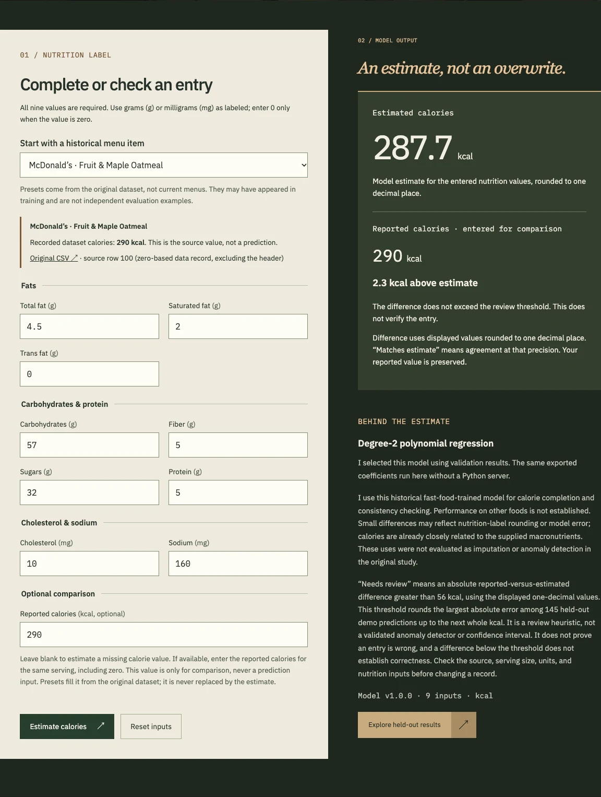
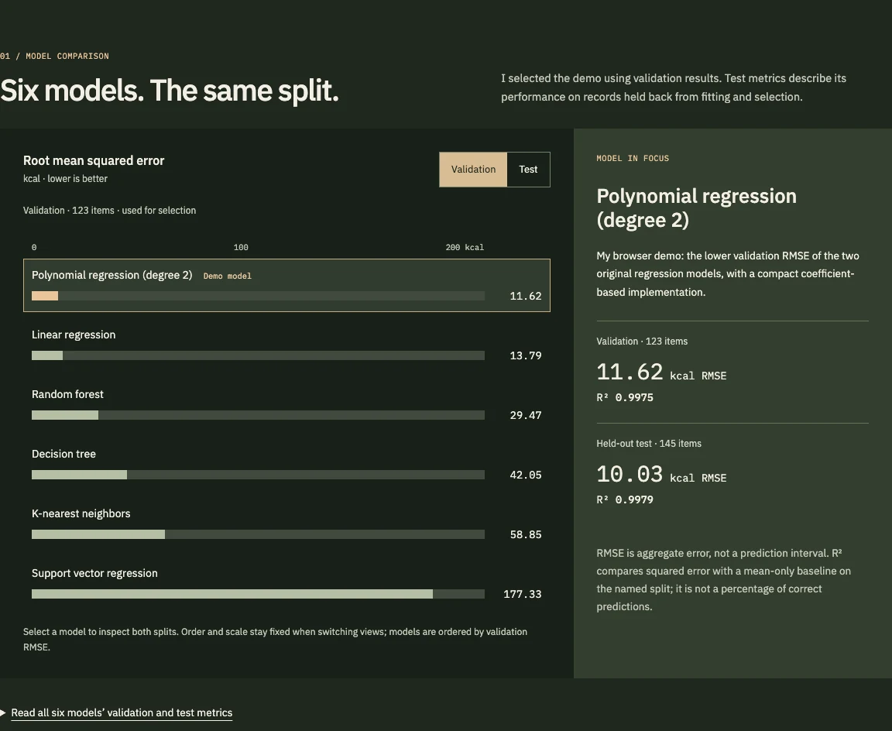

# PlatePredict

I built PlatePredict from my original fast-food regression project. The current browser app estimates missing calorie values and compares reported calories with a model estimate, without overwriting the reported value. It includes the original study, corrected results, and interactive findings.

PlatePredict is a legacy machine-learning project that was previously deployed on AWS EC2. That deployment is no longer running.

I previously deployed the project on EC2; I no longer maintain that deployment. This modernization runs predictions in the browser with React, TypeScript, and Vite. Python is used only for offline evaluation and model export. The static site is prepared for GitHub Pages but has not been deployed.

## Run locally

Use Node.js 22 or newer. From the repository root:

```sh
npm ci
npm run dev
```

Open **http://127.0.0.1:5173/platepredict/** (or the address printed by Vite if that port is occupied).

```sh
npm test
npm run build
npm run preview
```

The production preview is **http://127.0.0.1:4173/platepredict/**. The five HTML entry points support direct page links under `/platepredict/` without a routing fallback. Building writes to ignored `dist/`; it does not publish anything. No credentials, API keys, or Python server are needed to run the app. Fonts load from Google Fonts with system fallbacks; food images and the model are served locally.

## Actual app screenshots

The calorie tool compares a historical preset’s reported calories with the model estimate. Presets may have appeared in training; they are not independent evaluation examples.



The findings page distinguishes validation from test results and lets me inspect each model.



## Data and findings

My [notebook, CSV, and report](archive/originals/) remain byte-for-byte unchanged from the initial commit, with their titles and attribution preserved. The report is *Predicting Calories in Fast Food Items from Macronutrients*, by Erik Tran. I have not established an upstream dataset URL or redistribution license, and I do not assert a license for the historical materials.

I retain the notebook’s numeric conversion, positive-calorie requirement, and complete-input cleaning: **1,148 raw → 964 cleaned rows**. Restaurant, item, and zero-based source-row metadata stay separate from model values. The two `random_state=42` splits reserve 15% for test, then 15% of the remainder for validation: **696 training / 123 validation / 145 test**.

The ordered inputs are `Total_Fat_g`, `Saturated_Fat_g`, `Trans_Fat_g`, `Cholesterol_mg`, `Sodium_mg`, `Carbs_g`, `Fiber_g`, `Sugars_g`, and `Protein_g`. Units are grams except cholesterol and sodium, which use milligrams. Reported calories are never a prediction input.

| Model | Validation RMSE (kcal) | Validation R² | Test RMSE (kcal) | Test R² |
| --- | ---: | ---: | ---: | ---: |
| Linear | 13.793 | 0.996437 | 12.082 | 0.996968 |
| Polynomial, degree 2 | 11.623 | 0.997470 | 10.034 | 0.997909 |
| KNN | 58.848 | 0.935146 | 42.015 | 0.963334 |
| SVR | 177.330 | 0.411091 | 171.062 | 0.392205 |
| Decision tree | 42.053 | 0.966882 | 44.116 | 0.959576 |
| Random forest | 29.473 | 0.983732 | 26.769 | 0.985116 |

I selected degree-two polynomial regression using validation RMSE. Its 54 terms and intercept keep browser inference small while improving on linear regression. Models and preprocessing fit on training data only; test results do not select the model. The website reads [generated results](results/), including all 145 held-out observations/predictions and the original pre-cleaning EDA populations.

During modernization, I corrected reversed R² arguments in forest tuning, forest metrics that reused decision-tree predictions, and validation results mislabeled as test results. I preserved the original configurations and tuning candidates: tree leaf sizes `[1, 2, 5, 10, 15, 20, 25, 50, 100]` and forest sizes `[5, 10, 50, 100, 500]`. Validation selects leaf size 2 and 100 trees. The archived sources retain their historical outputs.

## Reproduce and export

Use Python 3.10 or newer; I verified a clean installation with Python 3.12.5. From the repository root:

```sh
python3 -m venv .venv
source .venv/bin/activate
python -m pip install -e .
python -m unittest discover -s tests -v
python -m platepredict.results archive/originals/FastFoodNutritionMenuV2.csv --output results
python -m platepredict.export archive/originals/FastFoodNutritionMenuV2.csv
python -m platepredict.eda archive/originals/FastFoodNutritionMenuV2.csv
npm test
npm run build
```

These commands regenerate the comparison and held-out results, `results/demo-model.v1.json`, `tests/fixtures/browser-parity.v1.json`, and `results/original-eda.json`. They do not modify the originals. I pin scikit-learn 1.7.2 because a later least-squares cutoff changed the polynomial fit’s numerical rank; this tested reproduction environment matches the saved scores, but the exact original environment is unknown.

The versioned model contains ordered features, units, training ranges, coefficients, intercept, and polynomial powers. It uses raw values without scaling and retains the training-only fit. The browser checks all 145 test records and 31 boundary cases against Python using `abs(actual − expected) ≤ 1e-7 + 1e-10 × abs(expected)` kcal. This is numerical tolerance, not an uncertainty interval. My verification found a maximum difference of about `4.55e-13` kcal.

## Behavior and limitations

- All nine nutrition values must be finite and nonnegative, for the same serving. Missing, invalid, and negative inputs are rejected. Out-of-training-range inputs produce warnings; estimates are not clamped. Model-load failures offer a retry, and edits hide stale results.
- Reported calories are optional. Blank means missing; zero is a supplied value. A missing value receives an estimate that should be checked and labeled as estimated before use. A negative model output remains visible but is unsuitable for filling a calorie value.
- When a reported value is supplied, I preserve it and show its difference from the estimate, using the displayed one-decimal values. **Needs review** means the absolute difference is **greater than 56 kcal**. That threshold is the ceiling of the largest absolute error in the 145 held-out predictions (about 55.50 kcal).
- This threshold is an empirical review heuristic, not a validated anomaly detector or confidence interval. The same held-out set supplies the threshold, so it does not independently validate the rule. Detection and false-alarm rates are unknown. A flag is a reason to check serving size, units, and source data; an unflagged entry is not verified correct.
- The original study evaluated regression on complete, positive-calorie records—not missing-value imputation or anomaly detection. Completion and consistency review are modernization uses. Performance on other foods or unseen restaurants is not established.
- Calories are already closely related to the supplied macronutrients. High R² is not percentage accuracy, nutritional quality, or a health score. Small discrepancies can reflect label rounding or model error.

## Verification and repository hygiene

I checked all five production pages at desktop and phone widths, including 320 px: navigation and skip links, visible keyboard focus, reduced motion, form validation, prediction/comparison behavior, model-load failure and retry, chart labels, and artifact values. The automated suites contain 20 Python tests and 22 browser-module tests. A clean installation reproduced the checked-in results and model files exactly. Browser layout checks used Chromium on macOS; other browser engines and assistive-technology combinations have not been exhaustively tested.

I keep compact results, the parity fixture, optimized photographs, and these screenshots in version control. Dependency folders, builds, caches, environment files, and common local credential files are ignored. The originals remain unchanged. No deployment is performed by the setup or build commands.

## Image sources

The decorative photographs illustrate the presentation, not dataset records or nutritional evidence. They share one neutral gray overlay treatment. The landing image has empty alt text; interior photos are CSS backgrounds.

| View | Photograph and original source | Local image |
| --- | --- | --- |
| Landing | [Daniel Torobekov’s toasted sandwich](https://www.pexels.com/photo/a-sandwich-on-a-wooden-board-13689827/) | `landing-sandwich.webp` |
| Overview | [Eduardo Alemán’s cheeseburger and fries](https://www.pexels.com/photo/cheeseburger-and-fries-on-a-wooden-board-11401287/) | `overview-burger.webp` |
| Estimator | [Jane T D.’s avocado, egg, and food bowl](https://www.pexels.com/photo/variety-of-food-on-wooden-coaster-793759/) | `estimator-nutrition.webp` |
| Findings | [Doğu Tuncer’s shrimp pasta](https://www.pexels.com/photo/a-pasta-on-a-black-plate-14537757/) | `findings-pasta.webp` |
| Case study | [Diana Light’s baking ingredients](https://www.pexels.com/photo/ingredients-on-wooden-table-10994431/) | `case-study-ingredients.webp` |

I verified each original source’s link to the [Pexels License](https://www.pexels.com/license/): free downloading, public website use, and modification are permitted without attribution. I serve optimized local WebP copies from `public/images`, with page-specific desktop and mobile crops and dark overlays. There are no visible photo credits. Interior photographs are decorative CSS backgrounds; the decorative landing image has empty alt text. The image license does not apply to the historical dataset or other project materials.
